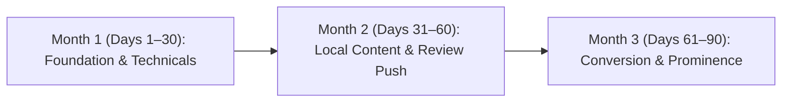

# 90-Day Local SEO Roadmap & Content Plan
**Client**: Sri Saraswathi Dental Clinic  
**Lead Doctor**: Dr. Kishore Kumar  
**Address**: 866, Soli Complex, Surampatti Four Road, Erode – 638009, Tamil Nadu, India  
**Target Market**: Erode, Surampatti, and nearby regions  
**Website**: `https://drkishoredentist.com`  

---

## 1. 12 High-Intent Local Educational Content Ideas (Content Strategy)

All medical content must be educational, medically accurate, reviewed by Dr. Kishore Kumar, and focused on genuine patient questions in Erode:

| # | Article Title / Topic | Target Primary Keyword | Target Search Intent | Target Audience in Erode |
|---|---|---|---|---|
| 1 | **How to Choose the Best Dental Clinic in Erode for Your Family** | Best Dental Clinic in Erode | Commercial / Guide | Families new to Erode or looking to switch dentists |
| 2 | **Root Canal Treatment in Erode: What Every Patient Should Know Before Booking** | Root Canal Treatment in Erode | Informational / Reassurance | Patients with acute toothache fearing pain |
| 3 | **Dental Implants vs Bridges: Which is Better for Missing Teeth?** | Dental Implants in Erode | Commercial / Decision | Adults with missing molars or front teeth |
| 4 | **Common Causes of Sudden Tooth Pain & What to Do Immediately** | Tooth Pain Treatment Erode | Informational / Emergency | Individuals experiencing acute sensitivity or throbbing pain |
| 5 | **How Much Does Dental Treatment Cost in Erode? A Patient Guide** | Dental Treatment in Erode | Commercial / Transparency | Price-conscious patients researching treatment fees |
| 6 | **Teeth Whitening in Erode: In-Clinic Treatment vs Home DIY Kits** | Teeth Whitening in Erode | Commercial / Educational | Young professionals and brides/grooms seeking brighter smiles |
| 7 | **When Does a Child Need Their First Dental Visit? A Pediatric Guide** | Pediatric Dentist in Erode | Informational / Parenting | Parents in Surampatti and Erode with young toddlers |
| 8 | **Wisdom Tooth Pain: When Is Extraction Necessary?** | Wisdom Tooth Extraction Erode | Informational / Clinical | Young adults aged 18–30 with jaw or ear pain |
| 9 | **Clear Aligners vs Traditional Metal Braces: Which Straightens Teeth Faster?** | Braces Treatment in Erode | Commercial / Comparative | Students and working professionals considering orthodontic care |
| 10 | **Why Are My Gums Bleeding When Brushing? Signs of Periodontal Disease** | Gum Treatment in Erode | Informational / Preventive | Adults with bleeding gums or bad breath |
| 11 | **How Often Should You Really Get Teeth Cleaning Done?** | Teeth Cleaning in Erode | Informational / Preventive | General public curious about tartar and scaling |
| 12 | **Dental Clinic in Surampatti, Erode: Location, Parking & Access Guide** | Dental Clinic in Surampatti | Local / Navigational | Local residents seeking nearby dental services at Surampatti Four Road |

---

## 2. 90-Day Execution Timeline

### Month 1 (Days 1 – 30): Foundation, On-Page & Technical Setup

- **Week 1: Technical & Routing Fixes**
  - Implement H1 fixes on Homepage, Dentists page, and Achievements page.
  - Enable standalone `/about` page (remove redirect to `/contact`).
  - Update `public/sitemap.xml` to include all treatment URLs, doctor profiles, and legal pages.
  - Fix duplicate LocalBusiness schema on `/contact` and enhance `Dentist` schema with `areaServed`.
  - Add contextual location section with Google Maps embed to Homepage.
- **Week 2: On-Page Optimization**
  - Incorporate core keywords naturally into Homepage hero, treatment overviews, and doctor intro.
  - Add internal links in `Footer.tsx` directly to all 8 clinical service pages.
  - Validate mobile responsiveness and Core Web Vitals on mobile.
- **Week 3: Google Business Profile (GBP) Activation**
  - Verify exact business name (*Sri Saraswathi Dental Clinic*), address, and Soli Complex map pin.
  - Fill all 9 detailed clinical service descriptions inside GBP.
  - Upload 10+ high-resolution authentic exterior, interior, and clinic chair photos.
  - Setup direct booking URL (`https://drkishoredentist.com/booking`).
- **Week 4: Local Citations**
  - Claim and standardize clinic NAP on Practo, Justdial, Lybrate, and Apple Maps.
  - Ensure 100% NAP consistency across every directory.

---

### Month 2 (Days 31 – 60): Content Expansion & Reputation Engine

- **Week 5: Publish Articles 1 & 2**
  - Publish *"How to Choose the Best Dental Clinic in Erode"* and *"Root Canal Treatment: Patient Guide"*.
  - Internal link from articles to `/treatments/root-canal-treatment` and `/booking`.
- **Week 6: Patient Review System Launch**
  - Place table-top QR review stand at clinic reception.
  - Introduce courteous WhatsApp follow-up for post-treatment feedback.
  - Target: Acquire 10–15 genuine, detailed patient reviews mentioning specific treatments and Erode.
- **Week 7: Publish Articles 3 & 4**
  - Publish *"Dental Implants vs Bridges"* and *"Sudden Tooth Pain Relief Guide"*.
  - Add relevant treatment FAQs based on real patient questions asked in clinic.
- **Week 8: Mid-Campaign Performance Check**
  - Check Google Search Console for impressions on target keywords.
  - Check Google Business Profile performance (calls, direction requests, website clicks).

---

### Month 3 (Days 61 – 90): Authority, Conversion Tuning & Sustainable Growth

- **Week 9: Publish Articles 5 & 6**
  - Publish *"Dental Treatment Cost Guide in Erode"* and *"Teeth Whitening Guide"*.
- **Week 10: Conversion Rate Optimization**
  - Verify appointment booking flow across mobile devices.
  - Check click-to-call phone tracking and WhatsApp button engagement.
- **Week 11: Competitor Gap Analysis**
  - Re-crawl top 3 competitors in Erode map pack.
  - Identify missing local citations or review volume gaps.
  - Publish Articles 7 & 8 (*"Pediatric Dental Visit"* and *"Wisdom Tooth Pain"*).
- **Week 12: Quarterly Review & Ongoing Strategy**
  - Generate 90-day progress report on keyword positions and organic traffic.
  - Set ongoing monthly cadence (2 blog articles/month, 10 reviews/month, 4 GBP posts/month).

---

## 3. Tracking & Measurement Framework

### 3.1. Google Search Console (GSC)
- **Primary Metric**: Organic search impressions and clicks for *Dentist in Erode*, *Best Dental Clinic in Erode*, *Dr Kishore Dentist*.
- **Crawl Health**: Ensure 0 soft-404 errors, 0 server errors (5xx), and valid sitemap indexing.
- **Action**: Check "Performance" -> "Queries" weekly to detect rising query impressions.

### 3.2. Google Analytics 4 (GA4)
- **Key Events to Track**:
  - `click_to_call`: Clicks on `tel:+919443256789`.
  - `click_to_whatsapp`: Clicks on WhatsApp chat link.
  - `appointment_submit`: Successful appointment form submissions on `/booking`.
  - `treatment_page_view`: Page views for individual treatment pages.
- **Geographic Filter**: Monitor engagement specifically from Tamil Nadu / Erode district visitors.

### 3.3. Google Business Profile Performance (GBP Insights)
- **Searches**: Track growth in *Direct searches* (people searching clinic name) vs *Discovery searches* (people searching "dentist" or "dental clinic").
- **Customer Actions**:
  - Phone calls generated directly from Google Maps.
  - Direction requests to 866, Soli Complex, Surampatti Four Road.
  - Website clicks to `https://drkishoredentist.com`.
